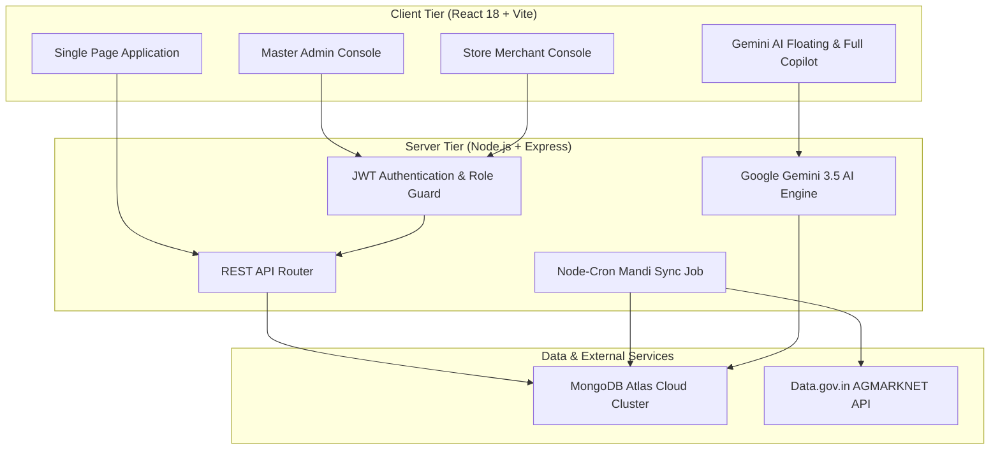

# MarketMind AI — System Architecture & Component Visual Showcase

This directory contains high-resolution presentation screenshots demonstrating every core component, workflow, and user interface state across the **MarketMind AI** platform.

The system is architected with complete role-based segregation:
1. **Store Merchant / Demo User Console** (`demo@marketmind.ai`) — Daily wholesale shopkeeping, APMC mandi benchmark tracking, inventory valuation, purchases, smart alerts, and Gemini AI Copilot.
2. **Master Platform Administration Console** (`admin@marketmind.ai`) — Multi-tenant management, live MongoDB Atlas cluster telemetry, API key management, model switching, and global cache flushes.

---

## 📸 Component Screenshot Catalog

### Section 1: Authentication & Onboarding
| # | Filename | Description | Target Audience |
|---|---|---|---|
| **01** | [`01_Merchant_Login_Screen.png`](./01_Merchant_Login_Screen.png) | Unified authentication portal featuring responsive branding and secure credentials validation. | Merchant / Admin |
| **02** | [`02_Merchant_Registration_Onboarding.png`](./02_Merchant_Registration_Onboarding.png) | Trader onboarding portal capturing store profile, contact info, and APMC yard association. | New Merchants |

---

### Section 2: Store Merchant & Mandi Trader Experience
| # | Filename | Description | Core Features Highlighted |
|---|---|---|---|
| **03** | [`03_Merchant_Dashboard_Overview.png`](./03_Merchant_Dashboard_Overview.png) | Executive command center. | • Total Products KPI (10 commodities) • Total Inventory Valuation (₹41,37,700) • Active Low-Stock Alerts Counter (2 items) • Recent Purchases inward feed • APMC Mandi price comparison ticker |
| **04** | [`04_Product_Catalog_Inventory_Management.png`](./04_Product_Catalog_Inventory_Management.png) | Live inventory catalog & stock monitor. | • Multi-category agricultural catalog (Rice, Spices, Pulses, Wheat, Oil) • Live stock quantities & unit measures • Weighted-average purchase cost vs retail selling price • Live APMC Mandi benchmark rate & % change delta |
| **05** | [`05_Add_Commodity_Modal_Form.png`](./05_Add_Commodity_Modal_Form.png) | Commodity creation interface. | • APMC commodity & variety tagging • Minimum stock alert threshold definition • Real-time margin calculator & markup suggestions |
| **06** | [`06_Commodity_Detail_Analytics_View.png`](./06_Commodity_Detail_Analytics_View.png) | Single-commodity deep-dive inspection. | • 30-day Mandi Price History trend chart • 10% vs 15% target margin recommendation cards • Physical inventory level gauge & supplier attribution |
| **07** | [`07_Live_APMC_Mandi_Benchmark_Rates.png`](./07_Live_APMC_Mandi_Benchmark_Rates.png) | Real-time Telangana APMC Mandi market feed. | • Live wholesale modal prices from data.gov.in AGMARKNET API • Multi-market coverage (Hyderabad, Warangal, Nizamabad) • Commodity price movement direction indicators |
| **08** | [`08_Purchases_Inward_Stock_Ledger.png`](./08_Purchases_Inward_Stock_Ledger.png) | Procurement ledger & inward entry. | • Inward purchase batch entry form with invoice references • Automatic weighted-average cost updating • Complete chronological procurement history table |
| **09** | [`09_Smart_Stock_Alerts_Center.png`](./09_Smart_Stock_Alerts_Center.png) | Intelligence alert center. | • Critical low-stock warnings (Red Chilli, Refined Sugar) • APMC Mandi wholesale surge alert (Nizamabad Turmeric +8.4%) • Gemini AI market demand & procurement suggestions |
| **10** | [`10_AI_Copilot_Full_Interactive_Chat.png`](./10_AI_Copilot_Full_Interactive_Chat.png) | Full-screen Google Gemini AI conversational copilot. | • Natural language mandi rate queries & profit inquiries • Structured execution receipts (`PROFIT_QUERY`, `ALERT_SET`) • Voice & text quick command cheat sheet |
| **11** | [`11_AI_Copilot_Market_Insights_Tab.png`](./11_AI_Copilot_Market_Insights_Tab.png) | Predictive market forecasting hub. | • Overall market trajectory ("Bullish / Inflationary Trend") • 7-14 day commodity price projections with confidence meters • Volatility, min/max/average price statistics |
| **12** | [`12_Floating_AI_Assistant_Drawer.png`](./12_Floating_AI_Assistant_Drawer.png) | Persistent global floating assistant. | • Accessible from any page without navigating away • Pre-configured quick action prompt chips • Real-time stock status checking & alert dispatch |
| **13** | [`13_Financial_Reports_Analytics.png`](./13_Financial_Reports_Analytics.png) | Business intelligence & valuation reports. | • Complete inventory ledger valuation breakdown • Date-range filtering & exportable CSV report button • Category-wise capital allocation summary |
| **14** | [`14_Merchant_Profile_Settings.png`](./14_Merchant_Profile_Settings.png) | Merchant store preferences. | • Business contact details & mandi location • Target profit margin percentage configuration • Preferred APMC market yards selector |

---

### Section 3: Master Platform Administration Experience
| # | Filename | Description | Core Capabilities |
|---|---|---|---|
| **15** | [`15_Admin_Manager_Dashboard_Overview.png`](./15_Admin_Manager_Dashboard_Overview.png) | System infrastructure telemetry console. | • Live MongoDB Atlas cluster connectivity & host address • Total document counters across all database collections • Server uptime, heap memory consumption & active Node runtime • Instant in-memory cache flush trigger |
| **16** | [`16_Admin_User_Management_Directory.png`](./16_Admin_User_Management_Directory.png) | Multi-tenant user directory. | • Platform administrator vs store merchant role segregation • Shop names, contact numbers, and registration timestamps • Granular user access controls |
| **17** | [`17_Admin_API_Keys_Configuration.png`](./17_Admin_API_Keys_Configuration.png) | External service credentials manager. | • Google Gemini AI API key validation & model status (`gemini-3.5-flash-lite`) • Data.gov.in AGMARKNET government resource linkage • Dynamic runtime reload without restarting processes |
| **18** | [`18_Admin_Platform_Settings_Console.png`](./18_Admin_Platform_Settings_Console.png) | Master administration console. | • System health telemetry and live collection statistics • Default mandi polling intervals (6-hour cron scheduler) • Emergency data maintenance & cache flushing controls |

---

## 🛠️ Technical Architecture Overview

---

## 📋 Client Presentation Summary

All screenshots in this directory were captured at **1920×1080 Full HD (1.25× High-DPI scale)** against the live database containing real Telangana agricultural commodities, APMC mandi rates, procurement logs, sales orders, and active Gemini AI insights.
